<div align="center">

<picture>
  <source media="(prefers-color-scheme: dark)" srcset="./assets/banner-dark.svg">
  <source media="(prefers-color-scheme: light)" srcset="./assets/banner-light.svg">
  
</picture>

<br>

[](https://github.com/Parth-KG/Flood-Prediction)
[](https://doi.org/10.5281/zenodo.20084689)
[](https://hashnode.com/@ParthKG)
[](https://www.linkedin.com/in/parth-krishan-goswami/)
[](mailto:parthkrishangoswami@gmail.com)

</div>

---

## The through-line

Most of what I build starts as a doubt about a number.

A brain-tumour MRI classifier of mine reported **95.19%**. I spent a summer at DRDO's Solid State Physics Laboratory finding out how much of that was real. Patient-level leakage was worth about **5.8 points** on its own. Roughly **85%** of the tumour images in the second dataset that gets used for "external validation" turned out to be duplicates of the first. And under the heaviest ImageNet-C-style noise, the same architecture trained on the source data fell to **38.5%** while its calibration error climbed, which is how a deployed model fails without anyone noticing.

That habit isn't only a research one. In a neural network I wrote from scratch, it meant reading the training loop until I understood why it wanted 2,000 epochs, and then not needing them. In a phone assistant over 3,356 government welfare schemes, it meant the model may only state a scheme, amount or rule that a retrieval tool returned, so it doesn't invent an eligibility rule for someone who is counting on the money.

<details>
<summary><sub><b>what the chart above is actually measuring</b></sub></summary>

<br>

One architecture, four evaluations, each more honest than the last — from [`neuroscan-ood`](https://github.com/Parth-KG/neuroscan-ood).

| Condition | Accuracy | What changed |
| :-- | --: | :-- |
| Leaky split | 96.0% | Random split — slices from one patient land on both sides |
| Grouped split | 90.2% | Split by patient, so no patient is in both sets |
| Corrupted | 66.4% | Mean at the strongest severity of six controlled, scanner-style corruptions |
| Noise | 38.5% | Gaussian noise, the worst of the six |

3,064 slices from 233 patients. The leakage gap holds over ten seeds (paired *t*-test, *p* < 0.001); every run is seeded and reproducible.

</details>

---

## Selected work

**Research**

| Project | What it is | Receipt |
| :-- | :-- | :-- |
| **[neuroscan-ood](https://github.com/Parth-KG/neuroscan-ood)** | An audit of a medical-imaging benchmark: patient leakage, cross-dataset duplication, corruption robustness, calibration, and label-free fixes. Config-driven package, unit-tested, CI on every push. | 5.8 pts of leakage · 2,335 duplicated images, every pair committed · AdaBN recovers most of the corruption loss with no labels (79.0% → 88.9% at mid severity) |
| **[Flood-Prediction](https://github.com/Parth-KG/Flood-Prediction)** | Five regressors on 28 years of Kanto-region flood records, tested on a chronological holdout, five rolling-origin windows, and water systems the models never saw. | Accepted at PAUL 2026 · the same ranking under all three tests · paper below |

**Built**

| Project | What it is | Receipt |
| :-- | :-- | :-- |
| **[Sarkari-Sahayak](https://github.com/Jagrit7/Sarkari-Sahayak)** | A voice assistant over 3,356 welfare schemes that works on any phone: call a number, press 1 for Hindi or 2 for English, and talk. Built in a team of four. | Top 4, Agent{a}thon 2026 · hybrid dense + BM25 retrieval with reranking · answers only from what its six retrieval tools return |
| **[MeraPaisa](https://github.com/Parth-KG/MeraPaisa)** | A native Android IOU and expense tracker, shipped solo. Multi-currency balances, lock-on-edit splits, and rollback to any past entry, with no account and no server. | Kotlin · Jetpack Compose · 636 tests, including every database migration |
| **[lang-helper-bot](https://github.com/Parth-KG/lang-helper-bot)** | A correction and translation bot, live on Telegram, WhatsApp and Discord: type in Hindi, Hinglish or English, or send an English voice note. | One platform-agnostic engine; each app is a thin adapter, so a fourth platform is one file, not a rewrite |

<sub>Also here: **[NeuroScan-AI](https://github.com/Parth-KG/NeuroScan-AI)** — the EfficientNet-B0 classifier that `neuroscan-ood` later took apart. **[explainable-vit-chest-xray](https://github.com/Parth-KG/explainable-vit-chest-xray)** — a Vision Transformer for chest X-rays, plus a quantitative test of whether its saliency maps can be trusted. **[MultiClass-Digit-Classification](https://github.com/Parth-KG/MultiClass-Digit-Classification)** — a 784–64–10 network with every gradient derived by hand in NumPy: 97.26% on MNIST, and 2,000 epochs down to 30 after rewriting the numerical core.</sub>

---

## Publication

**A Head-to-Head Study of Ensemble and Deep Learning Algorithms for Flood Damage Prediction in Japan**
P. K. Goswami, J. Arora and Indu · *accepted at the 9th International Conference on Pattern Analysis, Understanding and Learning (PAUL 2026)* · earlier preprint: [`10.5281/zenodo.20084689`](https://doi.org/10.5281/zenodo.20084689)

Random Forest, XGBoost, SVR, a deep neural network and linear regression, predicting per-capita flood damage across 5,704 events in 75 Kanto-region water systems from 1993–2020. No model is tested on a period overlapping its training data.

Best holdout result: **XGBoost, RMSE 0.805 · MAE 0.634 · R² 0.368**, with Random Forest 0.0025 RMSE behind. That gap isn't significant (Diebold–Mariano *p* = 0.45), so neither ensemble is the winner. What holds is the gap below them: the DNN, SVR and linear regression all trail XGBoost significantly (*p* < 0.001), and the ranking is the same on the chronological holdout, across the rolling windows, and on water systems held out entirely. Catchment area outranks every rainfall variable as a predictor.

---

## Toolbox

```
Languages     C++ · C · Python · Kotlin · Java · SQL · Bash
Systems       Linux (primary) · Git · GitHub Actions · gdb · Make · HDF5 · REST
ML            PyTorch · timm · scikit-learn · XGBoost · TensorFlow/Keras
              NumPy · Pandas · Grad-CAM · torchmetrics
Building      FastAPI · Flask · Weaviate · Qdrant · LiveKit · Streamlit · Jetpack Compose
Foundations   DSA · OOP · Operating Systems · DBMS · Networks · Theory of Computation
```

---

## Currently

- **B.Tech, Information Technology** (minor in AI/ML) at MSIT, GGSIPU — graduating Aug 2027.
- Extending the `neuroscan-ood` audit toward external validation across acquisition sources.
- Reading for graduate study in Japan. NAT-Test 5Q held, working toward N4: basic conversational Japanese, no more than that.
- Open to work in Delhi NCR or remote: applied ML, research engineering, or C++/Python systems.

---

<div align="center">
<sub>
If you're about to quote a benchmark number, I'd look at the split first.
</sub>
<br><br>
<a href="mailto:parthkrishangoswami@gmail.com">parthkrishangoswami@gmail.com</a> · <a href="https://www.linkedin.com/in/parth-krishan-goswami/">LinkedIn</a> · <a href="https://hashnode.com/@ParthKG">Hashnode</a>
</div>
